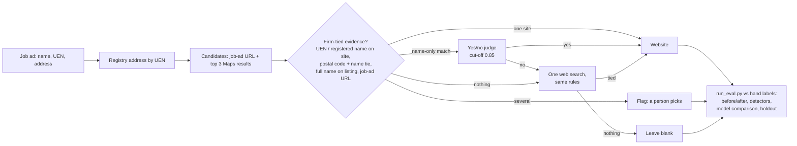

# llm-research-eval-harness

An eval harness for one step of an AI research agent: matching a company from a job ad to its own
website. It scores a naive "first search result" matcher, an evidence-based matcher and blind Claude
model judges against hand labels, then checks the result on a fresh holdout.

## The problem

An internal lead-research system at Flareworks finds Singapore small businesses that are hiring for
admin and enquiry work, finds each firm's website, finds a verified email on that domain, and drafts
a short note grounded in what the firm does. The website is the anchor for every later step.

The website step searched Google Maps for the company name and took the first result. A hand-labelled
sample of 60 firms showed that 12 of 50 websites belonged to a different business: a cleaning
marketplace instead of a cleaning company, a shopping mall instead of its tenant, a US freight firm
instead of a Singapore one. Ten of those twelve firms had no website at all, so the right answer was
blank, and the step guessed instead. Weighted to the whole run, roughly 1 in 5 leads with a website
pointed at the wrong company.

Nothing looked broken. Every wrong website loaded, had a phone number and matched its Maps listing,
because the listing and its website come from the same lookup.

## Approach



1. **Golden set split by the question each part answers.** 20 rows the system had flagged
   (recall), 30 random rows (accuracy), 10 rows left blank (misses). A suspicious sample can't give an
   accuracy figure, and a detector can't be scored on rows it selected itself.
2. **A check must not share an input with the thing it checks.** Domains are compared with the
   *registered* company name, never the Maps name.
3. **A search rank is not evidence.** A candidate counts only when something ties it to the
   registered company. Postal codes identify buildings, not businesses, so they need a name tie too.
   Directories, marketplaces and malls are research links, never the website.
4. **Blank is a valid answer**, and so is "several options, a person picks".
5. **Frozen inputs, repeated runs.** Searches and pages are cached, so only the judge can vary. Each
   variant runs three times to measure consistency.
6. **Model comparison on the same dossier.** Each model picks blind from the same frozen candidates.
7. **Fresh holdout.** The rules were tuned on the 60 firms, so the published number comes from 25 new
   firms run once with no changes afterwards.

## Results

Published numbers from the production evaluation (private data), restated from
[the article](https://tonytonggg.com/writing/evals-ai-web-research-crm). Full tables:
[`results/published.md`](results/published.md).

| | Before | After: benchmark (60) | After: fresh holdout (23) |
|---|---|---|---|
| **Wrong website** | 12/60 (20%) | 2/60 (3%) | **0/23** (95% bound: under 13%) |
| Right outcome, no human input | 46/60 (77%) | 55/60 (92%) | 19/23 (83%) |
| Right outcome after a person picks among flagged options | | | 22/23 (96%) |

- An 83% cut in wrong websites on the benchmark (12 to 2), and 64% fewer errors of any kind (14 to 5).
- "No website" firms correctly left blank: 0 of 10 before, 10 of 10 after.
- The old rule check caught 7 of 12 wrong websites (recall 58%, precision 64%).
- Four Claude models given the same frozen dossier (60 firms, 103 candidate sites, 3 runs each):

| Judge | Wrong | Missed | Right (of 60) | Same answer in all 3 runs |
|---|---:|---:|---:|---:|
| Rules + Jev (TypeSafe) | 2 | 3 | 55 | 60/60 |
| Claude Haiku | 1–2 | 5–6 | 53 | 57/60 |
| Claude Sonnet | 2–3 | 1–2 | 56 | 59/60 |
| Claude Opus | 2 | 2 | 56 | 60/60 |
| Claude Fable | 2 | 3 | 55 | 60/60 |

The three larger models and the rules land within one firm of each other. The gain from 46 to 55
came from what the judge was shown, not from the size of the model. The whole evaluation cost 1.5
hours of labelling and about US$0.30 in search and enrichment calls.

## Quickstart

No keys needed: the default judge is a deterministic mock, and all searches and pages are frozen in
`data/`.

```bash
git clone https://github.com/s0yabean/llm-research-eval-harness && cd llm-research-eval-harness
python3 run_eval.py --out results/latest          # about a second, US$0
python3 -m pip install -r requirements.txt && python3 -m pytest tests -q
```

On the synthetic set, the mock run gives 12 wrong / 46 right before, 2 wrong / 55 right after, and
0 wrong in the 23 scored holdout firms. The synthetic rows were built to the same composition and
failure types as the private set, so the shape matches; the numbers describe the synthetic set only.

With a real model (Claude via the Anthropic SDK, `ANTHROPIC_API_KEY` in your environment; see
`.env.example`):

```bash
python3 run_eval.py --judge claude:haiku                       # model for the yes/no step
python3 run_eval.py --models haiku,sonnet,opus,fable --runs 3  # blind four-model comparison, cost per model
```

Model IDs and prices for the cost column are in `config/models.json`. On the 60 synthetic firms a
four-model, three-run comparison is 720 short calls; check prices before running it.

## Repo layout

```
match.py               naive_match, evidence_match (the rebuilt step), rule_check (the old detector)
judges.py              pluggable judges: mock | claude:<alias>; yes/no and blind-pick modes; cost tracking
run_eval.py            detectors, before/after, judge scores, model comparison, holdout -> report.md
config/models.json     model IDs and US$/MTok for cost reporting
data/build_synthetic.py  generates every synthetic row, page and label (each row names its failure type)
data/dev_firms.jsonl     60 synthetic firms: 20 flagged, 30 random, 10 blank
data/holdout_firms.jsonl 25 synthetic holdout firms (2 labelled unsure)
data/pages.json          frozen page excerpts per domain (missing = site did not load)
data/labels/*.csv        hand labels: truth_website (domain | none | unsure) + note
results/published.md     the real, published numbers
results/synthetic-mock/  what the quickstart produces on the synthetic set
tests/                   pytest: matcher behaviour per failure type, set composition, blind dossier
```

## Design decisions and what I'd do next

- **The cut-off stayed at 0.85.** On the real set the judge rejected both right name-only candidates
  (0.70 and 0.40). Lowering the threshold would have fixed both, but choosing it from the test labels
  is tuning to the test. A judge needs two checks: consistency across runs, and agreement with the
  labels at the threshold actually used.
- **The mock judge is a stand-in, not a model.** It adds up page signals so the harness runs offline.
  Swap in `claude:<alias>` or add a backend with the same two methods (`own_site`, `pick`).
- **Rules over a bigger model.** Sonnet, Opus, Fable and the rules scored within one firm of each
  other, and the rules are free, instant and give the same answer every run.
- **Next:** grow the holdout batch by batch to narrow the 13% bound; add the downstream stages (email
  on the website's domain, grounded research) as their own eval sets now that their inputs are clean;
  move the sister-company duplicate the holdout surfaced into a dedupe check.

## Article

[How Evals Cut Wrong Matches in AI Web Research by 83%](https://tonytonggg.com/writing/evals-ai-web-research-crm)

Licence: MIT (see `LICENSE`).
